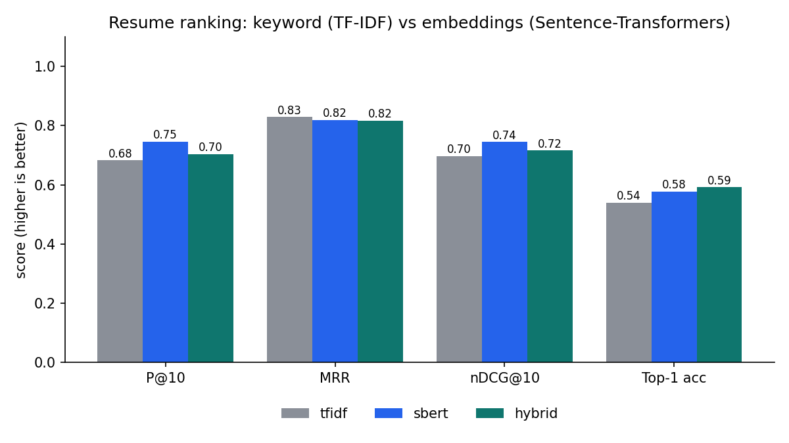

# AI-Based Resume Match Engine

Scores how well a resume matches a job description (0–100), shows which required skills are missing, and suggests fixes. It combines skill matching, **transformer sentence embeddings from Hugging Face (Sentence-Transformers, PyTorch)** and a TF-IDF keyword baseline. A benchmark on ~2,400 real resumes from Kaggle compares the embedding approach with the keyword-only baseline.

Works on PDF, DOCX and TXT, as a Streamlit web app, a command-line tool, or in Google Colab.

## How it works

```
 Resume (PDF/DOCX/TXT) ─┐                       ┌─► Skill coverage    (45%)
                        ├─► parse + clean ──────┼─► Semantic coverage (35%) ─► score 0–100
 Job description ───────┘   split JD into       └─► Keyword similarity (20%)     + missing skills
                            required / preferred                                  + improvement tips
```

1. **Parsing** – `pypdf` / `python-docx` read the files; emails, URLs and phone numbers are removed. The job description is split into *required* and *nice-to-have* parts.
2. **Skill coverage** – a list of ~50 skills with alternative names (Keras counts as TensorFlow, sklearn as scikit-learn). Knowing a specific skill implies the general one (LSTM → deep learning → machine learning). Required skills count 80%, nice-to-have 20%.
3. **Semantic coverage** – each line of the job description and of the resume is turned into a 384-number vector by `all-MiniLM-L6-v2`, a small pretrained transformer from the Hugging Face Hub, run with the Sentence-Transformers library on PyTorch. Lines with similar *meaning* get similar vectors, so "trained an LSTM for traffic forecasting" matches "time-series deep learning" even with no shared words. For each requirement, the closest resume line is kept as evidence.
4. **Keyword similarity** – TF-IDF cosine similarity between the two documents, the classic applicant-tracking-system approach.
5. **Feedback** – missing skills, weakly covered requirements, how many bullets have numbers, action verbs, and length.

If the model can't be downloaded (offline), the engine falls back to TF-IDF so it still runs.

## Benchmark: keywords vs embeddings

**Data:** [Kaggle Resume Dataset](https://www.kaggle.com/datasets/snehaanbhawal/resume-dataset) – ~2,400 real resumes, each labelled with one of 24 job categories (HR, Engineering, Teacher, Chef, …).

**Test:** `data/category_jds.json` has a short job description for each category. Every resume is ranked against every job description, and a resume counts as correct if its category matches the job.

**Methods:** `tfidf` (keywords), `sbert` (embeddings; long resumes are split into 150-word chunks and the best chunk is used, because the model reads at most ~256 tokens), and `hybrid` (average of both after putting them on the same scale).

| Metric | Plain meaning |
|---|---|
| P@10 | Of the 10 resumes ranked highest for a job, the share from the right category |
| MRR | How high the first correct resume appears (1.0 = always first) |
| nDCG@10 | Like P@10, but correct resumes at the very top count more |
| Top-1 acc | For each resume, is its best-matching job its true category? |

**Results** (2,483 resumes, 24 job categories, Google Colab T4 GPU):

| Method | P@10 | MRR | nDCG@10 | Top-1 acc | Time |
|---|---|---|---|---|---|
| TF-IDF (keywords) | 0.683 | **0.829** | 0.697 | 0.540 | 7 s |
| Sentence-Transformers (embeddings) | **0.746** | 0.819 | **0.745** | 0.578 | 74 s |
| Hybrid (average of both) | 0.704 | 0.817 | 0.716 | **0.592** | 81 s |



**What this shows**
- Embeddings put more correct resumes in the top 10: P@10 rose from 0.68 to 0.75, and nDCG@10 from 0.70 to 0.75.
- MRR is about the same for all three, so every method usually finds *one* correct resume near the top. The difference is in how many of the next ones are also correct.
- The hybrid is best at assigning each resume to its category (Top-1 accuracy 0.59) but not at ranking, so a simple 50/50 average isn't the best way to combine the two.
- Embeddings helped most where job titles vary and wording differs (Consultant 0.4 → 1.0, Advocate 0.3 → 0.6, Business Development 0.6 → 1.0). TF-IDF did better where exact domain words matter (Agriculture 1.0 vs 0.6, Healthcare 0.6 vs 0.4).
- Both methods do badly on Automobile and BPO, which have the fewest resumes (36 and 22) and overlap with other categories.
- Embeddings are about 10× slower (74 s vs 7 s on a T4 GPU).

**Caveats:** the 24 job descriptions were written for this test, results are from one run, and 24 jobs is a small number of queries, so treat small differences (like MRR) as ties.

## Run it

**Google Colab (easiest):** open `notebooks/benchmark_colab.ipynb` in Colab, choose a T4 GPU, upload the project zip when asked, and run all cells.

**On your computer:**
```bash
pip install -r requirements.txt
streamlit run app.py                                                    # web app
python cli.py --resume data/sample_resume.txt --jd data/sample_jd.txt   # one report
python cli.py --resume data/*.txt --jd data/sample_jd.txt --rank        # rank several resumes
python benchmark/run_benchmark.py --data path/to/Resume.csv             # benchmark
python -m pytest -q                                                     # tests
```
Use `--no-neural` to skip the embedding model and use TF-IDF only.

## Project structure
```
engine/parser.py          reads PDF/DOCX/TXT, cleans text, splits JD into required / preferred
engine/skills.py          skill list, alternative names, skill extraction
engine/matcher.py         scoring engine (skills + Sentence-Transformers + TF-IDF), ranking
benchmark/run_benchmark.py  TF-IDF vs embeddings on the Kaggle Resume Dataset
notebooks/benchmark_colab.ipynb  one-click Colab version of the benchmark
app.py / cli.py           Streamlit web app / command line
data/                     sample resumes, sample JD, 24 category job descriptions
tests/                    unit tests (pytest)
```

## Limitations
The skill list is written by hand; JD sections are detected with simple rules; score weights are fixed, not learned. The Kaggle categories overlap (e.g. Consultant vs Business Development), so no method reaches a perfect score. Next steps: learn the weights from labelled resume–job pairs and fine-tune the embedding model on resume text.
